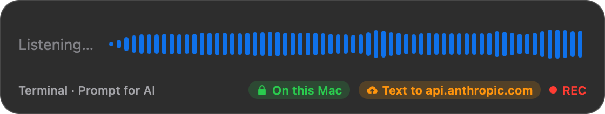
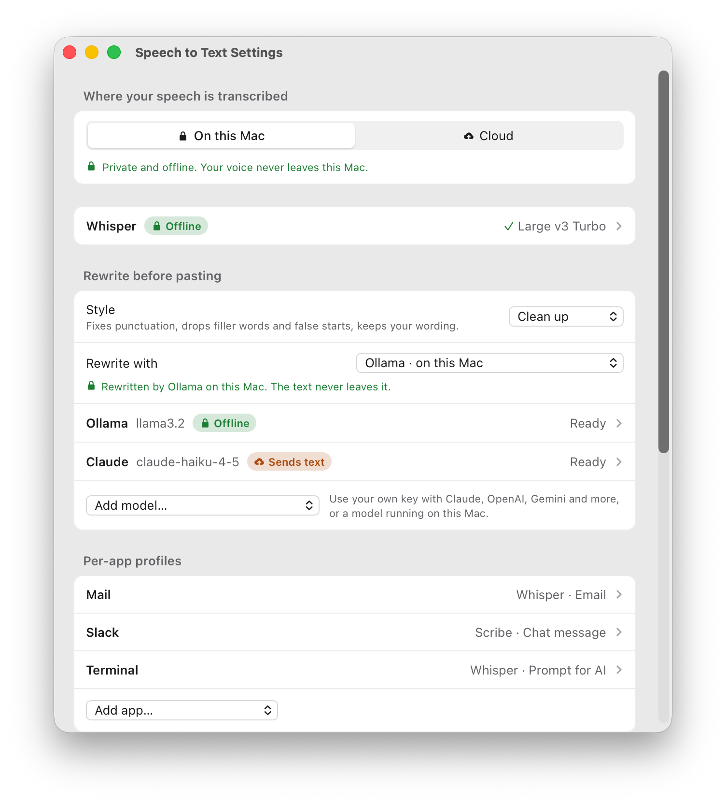
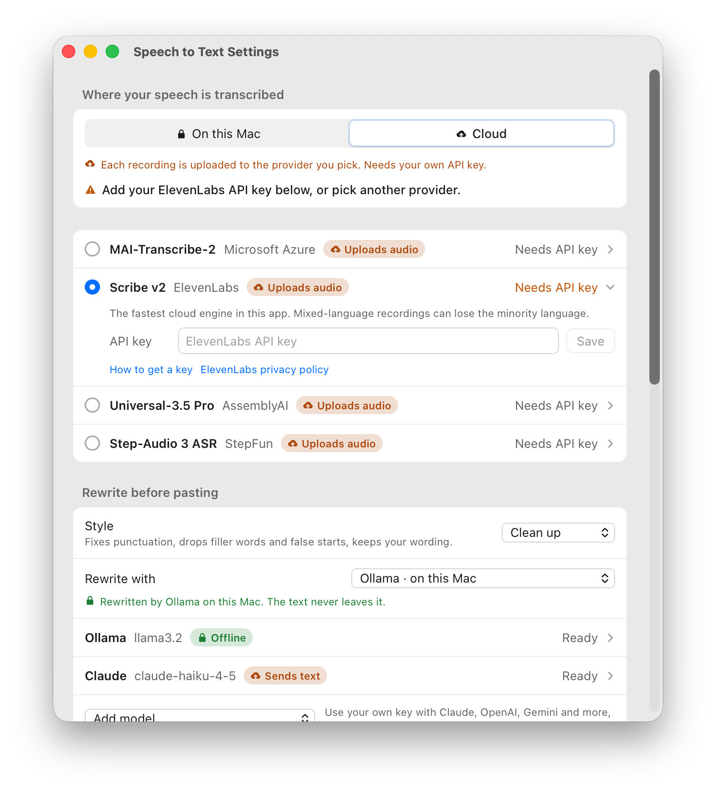
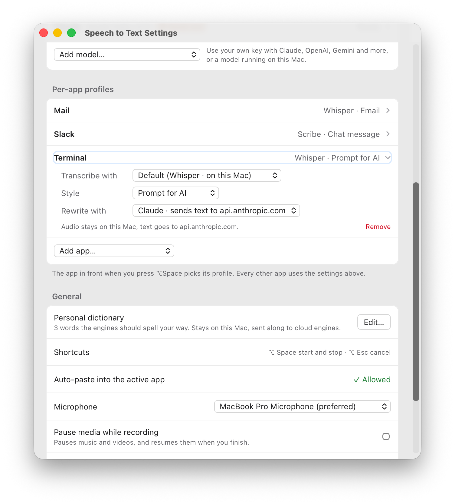
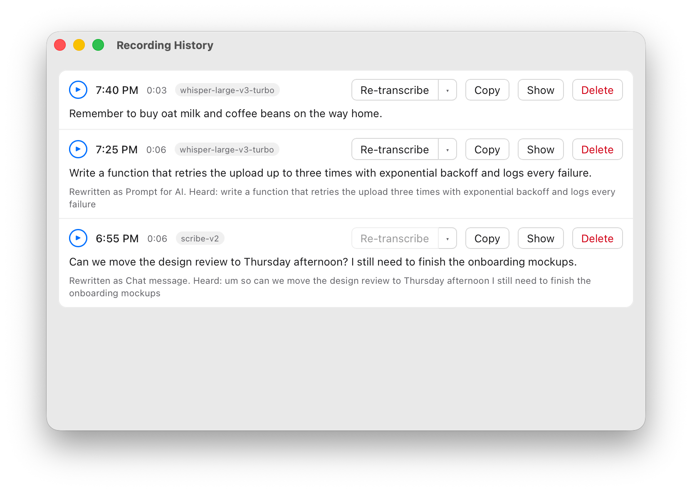

# Speech to Text

Free, open-source dictation that lives in your menu bar or system tray, on macOS, Windows and Linux.

Press **⌥ Space** (Alt+Space on Windows and Linux) anywhere, speak, press it again. Your words are typed into the app you are using and copied to the clipboard.

You choose where the speech is turned into text: **privately on your own computer**, or with a **cloud service** you bring your own key for. The app always shows which one is active.

<p align="center">
  
</p>

## What's new in 2.0

- **Windows and Linux.** The app was rebuilt with [Tauri](https://tauri.app), so the same app now runs on macOS, Windows and Linux.
- **Rewrite before pasting.** Optionally let a language model clean up the transcript, turn it into an email, a chat message or a prompt for an AI, or follow your own instructions. Use a model on your own computer (Ollama, LM Studio) or your own key for Claude, OpenAI, Gemini and more.
- **Per-app profiles.** The app in front picks the engine, the rewrite style and the model: a casual chat message in Slack, a clear prompt in your terminal, a proper email in Mail. Available on macOS and Windows.
- **Light on memory.** Whisper loads when you press the hotkey and unloads after 5 minutes without dictation. Version 1 kept Large v3 Turbo loaded, about 2 GB.
- **No more Keychain prompts.** API keys live in an encrypted file that only opens on your computer.

Coming from version 1? See [Upgrading from version 1](#upgrading-from-version-1-the-swift-mac-app).

## Where does my voice go?

| Engine | Where your audio goes | What you need |
|---|---|---|
| 🔒 **Whisper** (on this computer) | **Nowhere.** It is transcribed on your computer and works without internet. | A one-time model download in Settings (148 MB to 1.6 GB) |
| ☁️ **MAI-Transcribe-2** | Uploaded to **Microsoft Azure** | Your own Azure Speech key and endpoint |
| ☁️ **Scribe v2** | Uploaded to **ElevenLabs** | Your own ElevenLabs API key |
| ☁️ **Universal-3.5 Pro** | Uploaded to **AssemblyAI** | Your own AssemblyAI API key |
| ☁️ **GPT Transcribe** | Uploaded to **OpenAI** (OpenAI does not train on API audio) | Your own OpenAI API key |
| ☁️ **Step-Audio 3 ASR** | Uploaded to **StepFun** (servers in the US; StepFun may use recordings to improve its models) | Your own StepFun API key |

How you can tell at a glance:

- Settings starts with one switch: **On this Mac** (or **On this computer**) and **Cloud**. Cloud providers only appear once you pick Cloud, and each one is marked **Uploads audio** with the company's name.
- While you record, the overlay shows a badge: **🔒 On this Mac** or **☁️ Cloud · ElevenLabs** (or whichever provider you picked).
- The menu bar's Engine menu is split the same way.

<p>
  
  
</p>

Everything else stays on your computer too:

- **Recordings** are saved locally for 24 hours so nothing is lost if a transcription fails, then deleted automatically.
- **API keys** are kept in an encrypted file that only opens on this computer. There are no password prompts.
- **Your personal dictionary** is a local file that is never part of this repository.
- **No analytics, no telemetry, no account.** The app only goes online to download a model when you click Download, to reach the cloud engine you selected, and to reach a rewrite model if you add one.

If you dictate anything confidential at work, use Whisper, or check your company's rules for the cloud provider first.

## Install

You need **macOS 13** or newer, **Windows 10 or 11**, or a Linux desktop. The ready-made Mac download is for Apple Silicon (M1 or later); on an Intel Mac, build it yourself.

### Option 1: Download the app

Get the file for your system from the [latest release](https://github.com/JDrechsler/speech-to-text/releases/latest):

- **macOS:** the `.dmg`. Open it and drag **SpeechToText** into **Applications**. On first open, macOS says it cannot verify the developer, because this free app is not notarized by Apple. Click **Done**, then go to **System Settings → Privacy & Security**, scroll down and click **Open Anyway** next to SpeechToText.
- **Windows:** the `-setup.exe` (or the `.msi`). If SmartScreen says it protected your PC, click **More info → Run anyway**.
- **Linux:** the `.AppImage` (make it executable and run it), or the `.deb` / `.rpm` for your distribution.

### Option 2: Build it yourself

You need [Rust](https://rustup.rs) and [bun](https://bun.sh), plus:

- **macOS:** the developer tools: `xcode-select --install`
- **Windows:** [Visual Studio Build Tools](https://visualstudio.microsoft.com/visual-cpp-build-tools/) with "Desktop development with C++", [CMake](https://cmake.org/download/) and [LLVM](https://github.com/llvm/llvm-project/releases)
- **Debian or Ubuntu:** `sudo apt install build-essential cmake clang libwebkit2gtk-4.1-dev libayatana-appindicator3-dev librsvg2-dev libasound2-dev libxdo-dev libssl-dev`

```bash
git clone https://github.com/JDrechsler/speech-to-text.git
cd speech-to-text
bun install
bun tauri build
```

The finished app and installers are in `src-tauri/target/release/bundle/`.

## First start

1. **Settings opens by itself** with the Whisper row open. Click **Download** next to **Large v3 Turbo (compact)**. It is the recommended model: 574 MB, very accurate, 99 languages.
2. Press **⌥ Space** (Alt+Space), say something, press it again.
3. On a Mac, allow **Microphone** access when macOS asks, and **Accessibility** when asked. Accessibility lets the app paste the text for you. Without it the text is still copied to the clipboard and you paste with ⌘V.

Open Settings again any time from the menu bar icon → **Settings…**.

### Which Whisper model?

| Model | Download | Good for |
|---|---|---|
| Base | 148 MB | Quick tests, clear English |
| Small | 488 MB | Older or smaller computers |
| **Large v3 Turbo (compact)** | 574 MB | **Most people.** Near-best accuracy, 99 languages |
| Large v3 Turbo | 1.6 GB | The best accuracy |

The model is loaded when you press the hotkey and unloaded after 5 minutes without dictation, so the app uses almost no memory in between. The language is detected automatically. If it guesses wrong on short recordings, pick your language under **Spoken language**.

## Using a cloud engine (optional)

Cloud engines can be faster on older computers and handle some accents or mixed languages better. Each provider bills you for your usage on your own account.

Open **Settings** and switch to **Cloud**. Pick a provider with the round button, paste your key into the field that opens and click **Save**.

- **ElevenLabs Scribe v2:** create a key at [elevenlabs.io → Developers → API keys](https://elevenlabs.io/app/developers/api-keys).
- **AssemblyAI Universal-3.5 Pro:** copy your key from the [AssemblyAI dashboard](https://www.assemblyai.com/dashboard/api-keys).
- **StepFun Step-Audio 3 ASR:** create a key on the [StepFun platform](https://platform.stepfun.ai/interface-key). It understands English, Spanish, French, Chinese, Japanese and Korean, but not German, and it does not detect the language by itself: pick yours under **Spoken language** in its row.
- **Microsoft MAI-Transcribe-2:** in the Azure portal, create a Speech resource in a region that offers MAI-Transcribe (see [Microsoft's MAI-Transcribe guide](https://learn.microsoft.com/azure/ai-services/speech-service/mai-transcribe)). Copy **Key 1** and the **endpoint** (`https://<resource-name>.cognitiveservices.azure.com`) into Settings.

A cloud request that fails because of a network hiccup or a busy server is tried up to 3 times. A wrong key is reported right away.

## Rewrite before pasting (optional)

Under **Rewrite** in Settings, the transcript can be tidied up by a language model before it is pasted: **Clean up** (punctuation, filler words), **Email**, **Chat message**, **Prompt for AI**, or your own instructions, such as "Translate to English".

You add the model yourself: Claude, OpenAI, Gemini, Mistral, Groq, OpenRouter, any OpenAI-compatible server, or a model running on your own computer with Ollama or LM Studio. Only the text is sent, never the audio. A model on your own computer keeps the text there too, and Settings says which one applies.

**App profiles** choose the engine, rewrite style and model per app, for example a casual chat message in Slack and a clear prompt in your terminal. The app in front when you press the hotkey picks its profile, and each profile says in plain words where its audio and text go. Available on macOS and Windows.

<p align="center">
  
</p>

## Everyday use

| Action | How |
|---|---|
| Start, stop and paste | ⌥ Space (Alt+Space) |
| Cancel the current recording | ⌥ Esc (Alt+Esc) |
| Move the recording window out of the way | Drag it while you talk |
| See, replay, copy or re-transcribe the last 24 hours | Menu bar icon → History… |
| Choose a microphone | Menu bar icon → Microphone |
| Pause music and videos while you talk (macOS) | Menu bar icon → Pause Media While Recording |
| Start with your computer | Menu bar icon → Launch at Login |

<p align="center">
  
</p>

On Linux, the hotkey works on X11. On Wayland, bind a shortcut in your desktop settings to `speech-to-text --toggle` (and `speech-to-text --cancel`).

### Personal dictionary

Teach the engines names and jargon they keep misspelling: menu bar icon → **Edit Dictionary…**. Write one word or name per line, exactly as you want it spelled. It starts empty and lives only on your computer.

Keep it short, 50 entries at most. Rare names and product terms help, common words do not. Cloud engines receive these words with each recording. Rewrite models never do.

## Where things are stored

Everything lives in one folder:

| System | Folder |
|---|---|
| macOS | `~/Library/Application Support/SpeechToText/` |
| Windows | `%APPDATA%\SpeechToText\` |
| Linux | `~/.local/share/SpeechToText/` |

Inside it: `models/` (Whisper models), `recordings/` (kept 24 hours), `dictionary.txt`, `settings.json`, `profiles.json` (app profiles and rewrite models) and `api-keys.enc` (your keys, encrypted).

To remove everything, quit the app, uninstall it, and delete that folder.

## Upgrading from version 1 (the Swift Mac app)

Version 2 replaces the Mac-only app with one that runs on all three systems. Install it over the old one: your models, dictionary, history and settings carry over, and your API keys are copied out of the Keychain once. The old Keychain items are left in place; you can delete the "Speech to Text: …" items in Keychain Access afterwards. macOS may ask for Microphone and Accessibility once more.

## Let an AI agent set it up

This repository contains a [`CLAUDE.md`](CLAUDE.md) (also readable as `AGENTS.md`) that tells coding agents like Claude Code how to build the app, download models and configure engines for you. Open the folder in your agent and ask it to "set up Speech to Text for me".

## Credits

- [Tauri](https://tauri.app) runs the app on all three systems (MIT or Apache 2.0).
- [whisper.cpp](https://github.com/ggml-org/whisper.cpp) by Georgi Gerganov and contributors runs the offline engine (MIT), through [whisper-rs](https://crates.io/crates/whisper-rs).
- The Whisper models are by OpenAI (MIT), converted for whisper.cpp and downloaded from [Hugging Face](https://huggingface.co/ggerganov/whisper.cpp).
- [mediaremote-adapter](https://github.com/ungive/mediaremote-adapter) by Jonas van den Berg pauses and resumes media playback on macOS (BSD 3-Clause, included in `vendor/`).

## License

[MIT](LICENSE). Use it, change it, share it.
